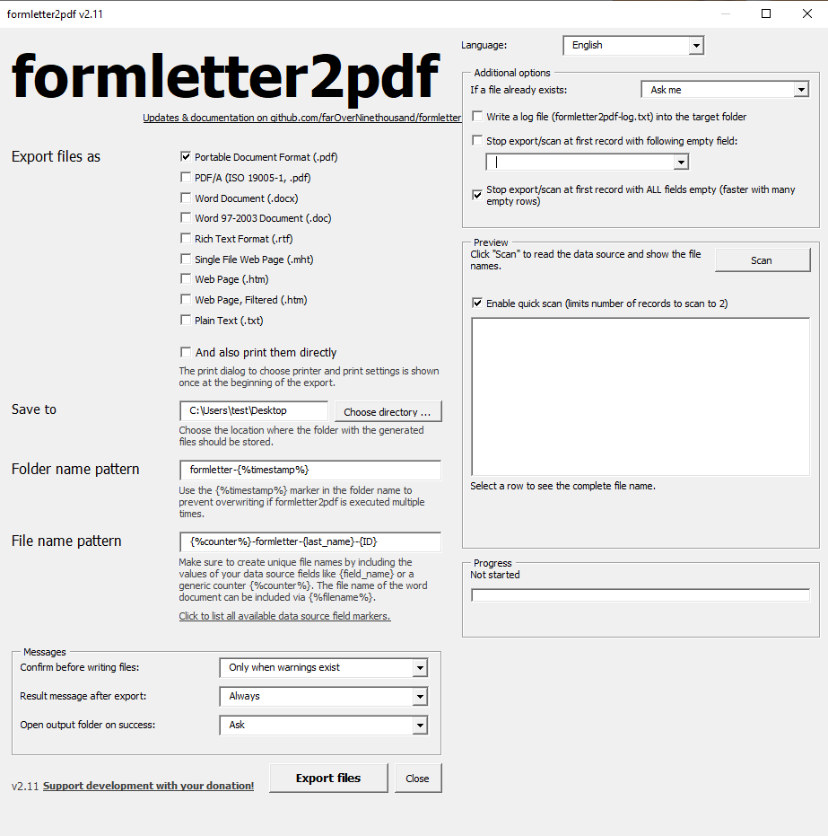

# formletter2pdf

Word macro to batch save multiple letters in user defined formats and file names. Enhanced version of original version from formletter2pdf.com with permission of the original developer.

> **Credits:** formletter2pdf was created by **Christian Bartl**. This project is an enhanced version of his original macro, published with his permission. Original website (development discontinued): [formletter2pdf.com](https://www.formletter2pdf.com/en/)

It extends Word's mail merge: every form letter is saved as its own file (PDF, DOCX, DOC, RTF, TXT, HTML, MHT, PDF/A) in a new folder, named from patterns like `{last_name}` or ``.

New in 2.11: file name preview, progress with abort and remaining time, handling of existing files, several file types at once, optional log file, English/German dialog. See [changelog.txt](changelog.txt).

## Install

The macro consists of two files in [`source/`](source): `formletter2pdf.bas` and `formletter2pdf_form.frm` (keep `formletter2pdf_form.frx` next to it).

1. In Word press `Alt+F11`. In the project tree (left) click **Normal** (not "Project (Document1)"). The macro only becomes permanent if it is imported into `Normal`.
2. `File > Import File...` and import both files. When updating, remove the old `formletter2pdf` module and form first (right click > Remove > *No* to export).
3. Check with `Debug > Compile Normal`.
4. Close the VBA editor and Word. If Word asks *"Save changes to the global template (Normal.dotm)?"* click **Yes** (Word often saves `Normal.dotm` without asking). Do not save your Word document for this.

After the import the macro is stored inside `Normal.dotm` (`%APPDATA%\Microsoft\Templates`). Word does not read the downloaded files again, so you can delete them. Keep them if you want to reinstall later, e.g. if `Normal.dotm` is reset or deleted.

If Word says that a VBA project cannot be saved in a document without macros, the files were imported into the document and not into `Normal`. Click **No**, remove the module and the form from the document's project and import them again into `Normal`. (Alternatively save that document as `.docm`, but then the macro only exists in this one file.)

If the macro does not show up, enable the **Developer** tab and allow macros in the Trust Center.

## Use

1. Create a mail merge letter (`Mailings > Start Mail Merge > Letters`), select recipients and insert merge fields. Do **not** click *Finish & Merge*.
2. Start the macro (`View > Macros > formletter2pdf > Run`, or the toolbar button below).
3. Choose file types, storage location, folder name pattern and file name pattern, optionally click **Scan** to preview the file names, then click **Export files**.

Defaults (file types, patterns, messages, language, ...) are set at the top of `formletter2pdf.bas`. Use `CustomDefaultFilenamePattern` for your own default file name pattern.

### Quick Access Toolbar

`File > Options > Quick Access Toolbar`, choose commands from **Macros**, select `Normal.formletter2pdf.formletter2pdf`, click **Add**, optionally **Modify...** for an icon and name, then **OK**.  
The button stays permanently and is visible in all Word documents you open because the macro lives in `Normal.dotm`.

### Updating this macro

1. Download the new files from [`source/`](source).
2. In Word press `Alt+F11` and click **Normal** in the project tree.
3. Remove the old `formletter2pdf` module and the old `formletter2pdf_form` form (right click > Remove > *No* to export). Importing without removing first causes errors like "ambiguous name".
4. Import the new `formletter2pdf.bas` and `formletter2pdf_form.frm` as described above (`.frx` next to the `.frm`).
5. Close Word. If Word asks whether to save `Normal.dotm`, click **Yes**.

If you changed the defaults at the top of `formletter2pdf.bas`, note them before removing the module and enter them again in the new file. The Quick Access Toolbar button keeps working.

## Compatibility

- Windows: Word 2010 and newer (including Microsoft 365 desktop). Word 2007 should work but is untested. Word 2003 is not supported.
- Resizable dialog, folder check, write-access check, PDF/A and opening the output folder are Windows only.
- Mac: Word for Mac 2016 and newer cannot import or edit macros with UserForms, so the macro cannot be installed there. Set it up on Windows and copy `Normal.dotm`. Not tested.
- Word Online and Word for mobile do not run macros.
- PDF output is Word's own export (no PDF security options). The macro must run *before* merging, an already merged document cannot be split.
- 2.11 has so far only been tested by hand in Word on Windows; please report problems as issues.

## License

Apache License 2.0, see [LICENSE](LICENSE). Original work Copyright 2013 Christian Bartl.
